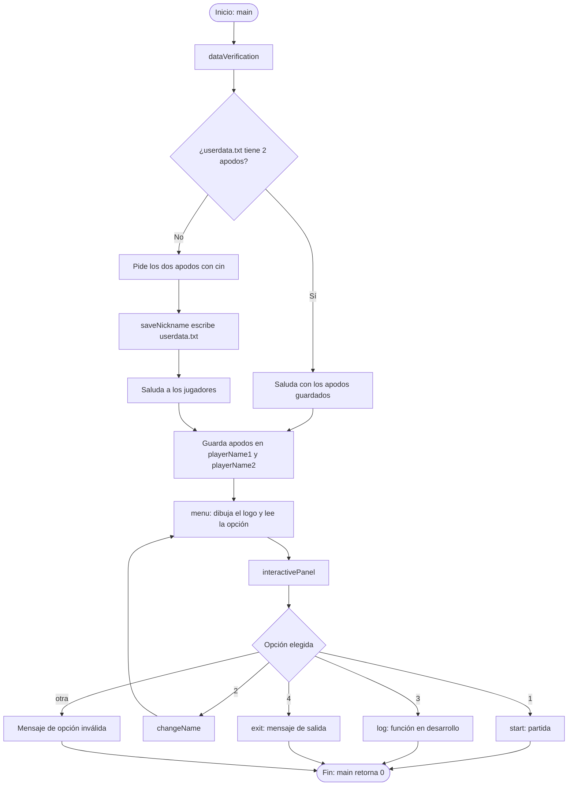
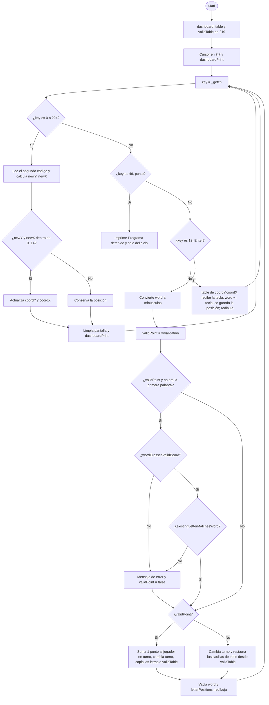
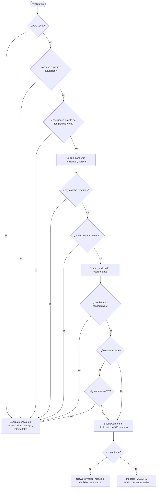
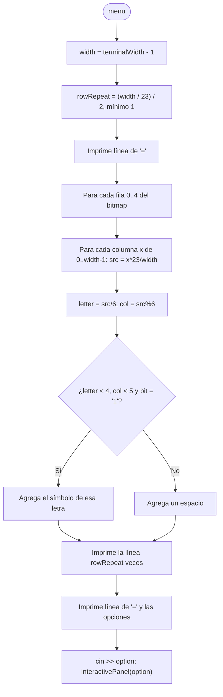

# Juego de Palabras en C++ (estilo Scrabble) — Documentación técnica

Juego de consola para **dos jugadores** escrito en C++ sobre un tablero de **15 x 15** casillas. Los jugadores se turnan para escribir palabras con el teclado, moviendo un cursor con las flechas. El programa valida la forma de la palabra (línea recta, casillas consecutivas, conexión con palabras anteriores) y la busca en un diccionario interno de 520 palabras en español.

> **Plataforma:** solo Windows. El código usa `conio.h` (`_getch`) y `windows.h` (`GetConsoleScreenBufferInfo`).

---

## Tabla de contenido

1. [Resumen rápido](#1-resumen-rápido)
2. [Compilación y ejecución](#2-compilación-y-ejecución)
3. [Estructura del proyecto](#3-estructura-del-proyecto)
4. [Cómo se juega](#4-cómo-se-juega)
5. [Arquitectura general](#5-arquitectura-general)
6. [Diagramas de flujo](#6-diagramas-de-flujo)
7. [Librerías incluidas](#7-librerías-incluidas)
8. [Variables globales](#8-variables-globales)
9. [Referencia de funciones](#9-referencia-de-funciones)
10. [Modelo de datos del tablero (`table` vs `validTable`)](#10-modelo-de-datos-del-tablero-table-vs-validtable)
11. [Reglas de validación en orden](#11-reglas-de-validación-en-orden)
12. [Limitaciones y errores conocidos](#12-limitaciones-y-errores-conocidos)
13. [Mejoras sugeridas](#13-mejoras-sugeridas)
14. [Cambios respecto al README anterior](#14-cambios-respecto-al-readme-anterior)

---

## 1. Resumen rápido

| Aspecto | Detalle |
| --- | --- |
| Lenguaje | C++ (un solo archivo: `main.cpp`, ~530 líneas) |
| Jugadores | 2, con apodos persistentes en `userdata.txt` |
| Tablero | `15 x 15`, cursor inicial en la casilla central `[7][7]` |
| Entrada | Flechas (mover), letras (escribir), `Enter` (validar), `.` (terminar) |
| Turnos | Sí, alternan J1 / J2 después de cada `Enter` |
| Puntaje | Provisional: +1 punto por palabra válida (valor de prueba) |
| Diccionario | 520 palabras (20 por cada letra, de la A a la Z) |
| Persistencia | Solo los apodos (`userdata.txt`) |

---

## 2. Compilación y ejecución

Con `g++` (MinGW) en Windows:

```
g++ main.cpp -o juego
juego.exe
```

Notas del entorno:

- El juego limpia la pantalla con la secuencia ANSI `\033[2J\033[1;1H`. En **Windows Terminal** funciona directamente; en consolas antiguas (`cmd.exe` sin soporte ANSI) puede imprimir caracteres extraños.
- Los bloques del tablero son los caracteres del código `219` (`█`) y el cursor es el `206` (`╬`) de la página de códigos 437/850 de la consola. Con otra página de códigos se verán otros símbolos.

---

## 3. Estructura del proyecto

```
scrabbleProyecto/
├── main.cpp        # Todo el código del juego
├── README.md       # Esta documentación
├── LICENSE
├── .gitignore
└── userdata.txt    # Se crea solo en la primera ejecución (2 apodos, uno por línea)
```

---

## 4. Cómo se juega

1. Al abrir el programa por primera vez se piden los apodos de los dos jugadores; se guardan en `userdata.txt` y no se vuelven a pedir.
2. En el menú se escribe `1` para jugar.
3. Se dibuja el tablero con el cursor (`╬`) en el centro.
4. El jugador en turno **mueve el cursor** con las flechas y **escribe una letra por casilla** hasta formar su palabra.
5. Con **Enter** se valida la palabra:
   - Si es válida: se suma 1 punto al jugador en turno y las letras quedan fijas en el tablero.
   - Si no lo es: se muestra el motivo, las letras escritas se borran y el turno pasa igualmente al otro jugador.
6. La tecla **punto (`.`)** termina el programa.

El encabezado del tablero muestra siempre los apodos, de quién es el turno, los puntos de cada jugador y el último mensaje de validación.

---

## 5. Arquitectura general

El programa es una **cadena de llamadas** que baja desde `main` hasta el ciclo del juego:

```
main
 ├── dataVerification ── saveNickname
 └── menu
      └── interactivePanel
           ├── (1) start ── dashboard, dashboardPrint, wValidation,
           │                 wordCrossesValidBoard, existingLetterMatchesWord
           ├── (2) changeName ── saveNickname  → vuelve a menu()
           ├── (3) log
           ├── (4) exit
           └── otra → mensaje de opción inválida
```

Puntos clave de diseño:

- **No existe un ciclo de menú.** Después de la opción 1, 3, 4 o una opción inválida, las funciones retornan en cadena y el programa termina. Solo la opción 2 vuelve a mostrar el menú (llamando a `menu()` de nuevo, es decir, por recursión).
- **Estado global.** Tablero, turno, puntos, nombres y último mensaje viven en variables globales; `start()` solo conserva localmente la palabra en construcción, sus posiciones y la bandera de primera palabra.
- **Dos tableros.** `table` es el tablero "de trabajo" (lo que el jugador va escribiendo) y `validTable` es el tablero "confirmado" (lo que ya fue aceptado). Ver [sección 10](#10-modelo-de-datos-del-tablero-table-vs-validtable).

---

## 6. Diagramas de flujo

Los diagramas están en [Mermaid](https://mermaid.js.org/), que GitHub renderiza automáticamente.

### 6.1 Flujo general del programa



### 6.2 Ciclo principal de la partida (`start`)



### 6.3 Validación de la palabra (`wValidation`)



### 6.4 Construcción del logo del menú (`menu`)



---

## 7. Librerías incluidas

| Librería | Para qué se usa en el código |
| --- | --- |
| `<iostream>` | `cout` / `cin`: mostrar texto y leer apodos y opciones del menú |
| `<fstream>` | `ifstream` / `ofstream`: leer y escribir `userdata.txt` |
| `<string>` | `string` para apodos, palabra en construcción, diccionario y mensajes |
| `<conio.h>` | `_getch()`: leer una tecla al instante sin esperar Enter (solo Windows) |
| `<cctype>` | `tolower()` en `existingLetterMatchesWord` |
| `<vector>` | `vector<pair<int,int>>` para las posiciones de las letras; `vector<int>` para las coordenadas en `wValidation` |
| `<algorithm>` | `sort()` para ordenar coordenadas y comprobar que sean consecutivas |
| `<windows.h>` | `CONSOLE_SCREEN_BUFFER_INFO`, `GetStdHandle`, `GetConsoleScreenBufferInfo` para medir el ancho de la consola |

`using namespace std;` evita escribir el prefijo `std::`.

---

## 8. Variables globales

| Variable | Tipo | Valor inicial | Descripción |
| --- | --- | --- | --- |
| `table` | `char[15][15]` | sin inicializar (se llena en `dashboard`) | Tablero de trabajo: muestra lo que se está escribiendo en este momento, más las letras ya confirmadas. Cada casilla vacía contiene el código `219`. |
| `validTable` | `unsigned char[15][15]` | sin inicializar (se llena en `dashboard`) | Tablero confirmado: solo las letras de palabras ya aceptadas. Se usa para saber qué casillas están ocupadas y para restaurar `table` cuando una palabra falla. Es `unsigned char` para poder comparar sin problemas con `219`. |
| `turn` | `int` | `1` | Jugador en turno (1 o 2). Alterna tras cada Enter. |
| `pts1` | `int` | `0` | Puntos del jugador 1. |
| `pts2` | `int` | `0` | Puntos del jugador 2. |
| `playerName1` | `string` | `"Jugador 1"` | Apodo del jugador 1 (lo actualizan `dataVerification` y `changeName`). |
| `playerName2` | `string` | `"Jugador 2"` | Apodo del jugador 2. |
| `lastValidationMessage` | `string` | `""` | Último mensaje de validación; `dashboardPrint` lo muestra bajo el encabezado si no está vacío. |
| `words` | `string[28]` | A, E, I, L, N, O, R, S, T, U, D, G, B, C, M, P, F, H, V, Y, CH, Q, J, LL, Ñ, RR, X, Z | Alfabeto de fichas del juego. **No se usa todavía.** No incluye K ni W. |
| `player1Cantidad` | `int[28]` | 12, 12, 6, 4, 5, 9, 5, 6, 4, 5, 5, 2, 2, 4, 2, 2, 1, 2, 1, 1, 1, 1, 1, 1, 1, 1, 1, 1 | Fichas disponibles por letra para el jugador 1 (mismo orden que `words`; suman 98). **No se usa todavía.** |
| `player2Cantidad` | `int[28]` | igual que `player1Cantidad` | Fichas disponibles por letra para el jugador 2. **No se usa todavía.** |

> Los valores `219` y `206` son "números mágicos" (bloque `█` y cursor `╬`). Conviene reemplazarlos por constantes con nombre (ver [mejoras](#13-mejoras-sugeridas)).

---

## 9. Referencia de funciones

### Índice

| Función | Línea | Propósito |
| --- | --- | --- |
| `terminalWidth` | 28 | Ancho de la consola |
| `main` | 52 | Punto de entrada |
| `saveNickname` | 59 | Guarda apodos en archivo |
| `dataVerification` | 70 | Carga o pide apodos |
| `menu` | 92 | Logo, opciones y lectura de opción |
| `start` | 136 | Ciclo de la partida |
| `changeName` | 248 | Cambia apodos |
| `log` | 262 | Registro de resultados (pendiente) |
| `exit` | 266 | Mensaje de salida |
| `interactivePanel` | 270 | Despachador de opciones |
| `dashboard` | 290 | Inicializa los tableros |
| `dashboardPrint` | 299 | Dibuja encabezado y tablero |
| `wordCrossesValidBoard` | 319 | La palabra toca o cruza letras confirmadas |
| `existingLetterMatchesWord` | 343 | Letras reutilizadas coinciden |
| `wValidation` | 359 | Reglas y diccionario |

*(Las líneas corresponden a la versión actual de `main.cpp`.)*

---

### `int terminalWidth()`

Devuelve el ancho útil de la consola, en caracteres.

- **Variables locales:** `csbi` (`CONSOLE_SCREEN_BUFFER_INFO`): estructura de la API de Windows que se llena con la información de la consola.
- **Funcionamiento:** llama a `GetConsoleScreenBufferInfo` sobre la salida estándar (`GetStdHandle(STD_OUTPUT_HANDLE)`). Si tiene éxito, calcula `Right - Left + 1` de la ventana visible. Si falla (por ejemplo, la salida está redirigida), devuelve `80`.
- **Usada por:** `menu`.

### `int main()`

Punto de entrada.

- **Variables locales:** `nickname1`, `nickname2` (`string`): reciben los apodos desde `dataVerification`. Después de eso no se vuelven a usar; el resto del programa lee `playerName1` y `playerName2`.
- **Funcionamiento:** llama a `dataVerification` y luego a `menu`. Retorna `0`.

### `void saveNickname(const string& nickname1, const string& nickname2)`

Escribe los apodos en `userdata.txt`.

- **Parámetros:** `nickname1`, `nickname2`: apodos a guardar (por referencia constante, sin copiarlos).
- **Variables locales:** `userFile` (`ofstream`): flujo de salida al archivo.
- **Funcionamiento:** abre `userdata.txt` (lo crea o **lo sobrescribe**), escribe `nickname1`, salto de línea, `nickname2`, salto de línea, y cierra. Si no puede abrirlo, imprime `No se pudo guardar el nickname`.
- **Efectos secundarios:** modifica el archivo `userdata.txt`.

### `void dataVerification(string& nickname1, string& nickname2)`

Decide si pedir los apodos o cargarlos del archivo.

- **Parámetros:** `nickname1`, `nickname2` (por referencia): salida; se llenan con los apodos.
- **Variables locales:** `userFile` (`ifstream`): flujo de entrada de `userdata.txt`.
- **Funcionamiento:**
  1. Intenta leer dos palabras con `userFile >> nickname1 && userFile >> nickname2`.
  2. Si ambas lecturas funcionan: saluda con `Bienvenidos nuevamente`.
  3. Si no (archivo inexistente o incompleto): pide los apodos por `cin`, los guarda con `saveNickname` y saluda.
  4. En ambos casos copia los apodos a las globales `playerName1` y `playerName2`.
- **Nota:** `>>` y `cin >>` leen **hasta el primer espacio**, así que los apodos no pueden tener espacios.

### `int menu()`

Dibuja el logo "MENU", muestra las opciones, lee la elección y la envía a `interactivePanel`.

- **Variables locales:**
  - `option` (`int`): opción escrita por el usuario.
  - `letters[4][5]` (`const string`): mapa de bits de las letras **M, E, N, U**; cada letra son 5 filas de 5 caracteres (`'1'` = pintar, `'0'` = vacío).
  - `symbols[4]` (`const char`): `'#'`, `'@'`, `'%'`, `'&'`; símbolo con que se dibuja cada letra.
  - `width` (`const int`): `terminalWidth() - 1`, para evitar un salto de línea extra al llenar la fila completa.
  - `totalCols` (`const int`): `4 * 5 + 3 = 23`; columnas del bitmap original (4 letras de 5 columnas más 3 espacios separadores).
  - `rowRepeat` (`int`): veces que se repite cada fila para que el logo mantenga proporción (`(width / totalCols) / 2`, mínimo 1; el `/ 2` compensa que un carácter es más alto que ancho).
  - `row` (`int`, 0–4): fila del bitmap.
  - `line` (`string`): línea de texto que se va armando.
  - `x` (`int`): columna de pantalla (0 a `width - 1`).
  - `src` (`int`): columna del bitmap original equivalente, `x * totalCols / width` (escalado horizontal).
  - `letter` (`int`): índice de la letra, `src / 6` (cada letra ocupa 5 columnas + 1 de separación).
  - `col` (`int`): columna dentro de la letra, `src % 6` (la columna 5 es el separador y nunca pinta).
  - `r` (`int`): contador de repeticiones de fila.
- **Funcionamiento:** imprime una línea de `=`, genera el logo ampliado al ancho de la consola, imprime otra línea de `=`, muestra las cuatro opciones, lee `option` con `cin` y llama a `interactivePanel(option)`.
- **Retorno:** `option` (el valor de retorno no se usa en ninguna parte).
- **Nota:** si el usuario escribe algo que no es un número, `cin` falla y `option` queda en `0`, lo que cae en el caso de opción inválida.

### `void interactivePanel(int x)`

Despachador del menú (un `switch`).

- **Parámetros:** `x`: opción elegida.
- **Casos:**
  - `1` → `start()`.
  - `2` → `changeName()` y después `menu()` (recursión: vuelve a mostrar el menú).
  - `3` → `log()`.
  - `4` → `exit()`.
  - otro → imprime `ESA OPCIÓN ES INVÁLIDA(x)`.

### `string changeName()`

Pide nuevos apodos y los reemplaza.

- **Variables locales:** `newNickname1`, `newNickname2` (`string`).
- **Funcionamiento:** lee ambos con `cin`, los guarda con `saveNickname` (sobrescribe el archivo) y actualiza `playerName1` y `playerName2`.
- **Retorno:** `newNickname1` (el valor devuelto no se usa).

### `void log()`

Pendiente. Solo imprime `FUNCION EN DESARROLLO`. Está pensada para el registro de resultados (opción 3).

### `void exit()`

Solo imprime `SALIENDO DEL PROGRAMA...`. **No termina el proceso por sí misma**: el programa acaba porque las funciones retornan hasta `main`. Además comparte nombre con `exit(int)` de la librería estándar (sobrecarga), y `log()` con `log(double)` de `<cmath>`; conviene renombrarlas.

### `void dashboard()`

Inicializa ambos tableros.

- **Variables locales:** `i`, `j` (`int`): índices de fila y columna.
- **Funcionamiento:** recorre las 225 casillas y asigna `219` (bloque sólido) tanto en `table` como en `validTable`. `219` significa "casilla vacía".

### `void dashboardPrint(int cursorY, int cursorX)`

Dibuja el encabezado y el tablero.

- **Parámetros:** `cursorY`, `cursorX`: fila y columna del cursor.
- **Variables locales:** `i`, `j` (`int`): índices.
- **Funcionamiento:**
  1. Imprime `Bienvenidos, <J1> y <J2>`.
  2. Imprime `Turno: J<turn> | Puntos J1: <pts1> | Puntos J2: <pts2>`.
  3. Si `lastValidationMessage` no está vacío, lo imprime.
  4. Recorre el tablero: en `[cursorY][cursorX]` pinta el carácter `206` (cursor) y en las demás casillas el contenido de `table[i][j]`. Cada casilla va entre espacios y cada fila se separa con una línea en blanco.
- **Nota:** como el cursor tapa la casilla donde está, la letra de esa casilla no se ve mientras el cursor esté encima.

### `void start()`

Ciclo de la partida: lee teclas, mueve el cursor, escribe letras y valida palabras.

- **Constantes locales:** `KEY_UP = 72`, `KEY_DOWN = 80`, `KEY_LEFT = 75`, `KEY_RIGHT = 77`: segundo código que devuelve `_getch()` para cada flecha.
- **Variables locales:**
  - `word` (`string`): palabra en construcción (en el orden en que se escribieron las letras).
  - `letterPositions` (`vector<pair<int,int>>`): posición `(fila, columna)` de cada letra de `word`, en el mismo orden.
  - `firstWord` (`bool`): `true` hasta que se acepte la primera palabra. (Se asigna `true` dos veces seguidas; una es redundante.)
  - `coordX`, `coordY` (`int`): columna y fila del cursor; empiezan en `7`.
  - `key` (`int`): tecla leída con `_getch()`.
  - `newY`, `newX` (`int`): posición candidata al mover el cursor.
  - `wasFirstWord` (`bool`): copia de `firstWord` antes de validar, porque `wValidation` la puede cambiar.
  - `validPoint` (`bool`): resultado final de la validación completa.
  - `c` (`char&`, dentro del `for`): cada carácter de `word` al pasarlo a minúsculas.
  - `position` (`const auto&`, dentro de los `for`): cada par de `letterPositions`.
- **Funcionamiento por tipo de tecla:**
  - **`0` o `224`:** prefijo de tecla especial. Se lee un segundo `_getch()`; según su valor se ajusta `newY`/`newX`. Si la nueva posición está dentro de `0..14` se acepta. Luego limpia la pantalla (`\033[2J\033[1;1H`) y redibuja.
  - **`46` (`.`):** imprime `Programa detenido.` y sale del ciclo; al volver a `main` el programa termina.
  - **`13` (Enter):** valida la palabra (ver abajo).
  - **Cualquier otra tecla:** `table[coordY][coordX]` recibe la tecla, se agrega a `word`, se guarda `(coordY, coordX)` en `letterPositions` y se redibuja.
- **Al presionar Enter:**
  1. Se borra `lastValidationMessage`.
  2. `word` se convierte a minúsculas (solo `A`–`Z`).
  3. Se llama `wValidation(word, letterPositions, firstWord)`.
  4. Si fue válida **y no era la primera palabra**, se aplican dos comprobaciones extra: `wordCrossesValidBoard` y `existingLetterMatchesWord`. Si alguna falla, se pone el mensaje correspondiente y `validPoint = false`.
  5. **Si es válida:** suma 1 punto a `pts1` (si `turn == 1`) o `pts2`, cambia el turno y copia cada letra de `table` a `validTable` (confirma las letras).
  6. **Si no es válida:** cambia el turno igualmente y restaura cada casilla de `letterPositions` en `table` con su valor de `validTable` (las casillas vacías vuelven a `219` y las ya confirmadas conservan su letra).
  7. Vacía `word` y `letterPositions`, limpia la pantalla y redibuja.
- **Importante:** a diferencia del README anterior, **el ciclo no termina después de validar**; sigue hasta que se presione `.`.

### `bool wordCrossesValidBoard(const vector<pair<int,int>>& letterPositions)`

Comprueba que una palabra nueva (no la primera) se **conecte** con lo ya confirmado.

- **Parámetros:** `letterPositions`: posiciones de la palabra candidata.
- **Variables locales:** `position`, `y`, `x` (posición actual); `dy[]` = `{-1, 1, 0, 0}` y `dx[]` = `{0, 0, -1, 1}` (desplazamientos arriba, abajo, izquierda, derecha); `i` (índice de dirección); `adjacentY`, `adjacentX` (casilla vecina).
- **Funcionamiento:** para cada letra de la palabra devuelve `true` si
  - esa casilla ya está ocupada en `validTable` (la palabra **cruza** una letra existente), o
  - alguna de sus 4 casillas vecinas (con límites controlados) está ocupada en `validTable` (la palabra **toca** una letra existente).
  Si ninguna letra cumple, devuelve `false`.

### `bool existingLetterMatchesWord(const string& word, const vector<pair<int,int>>& letterPositions)`

Comprueba que, donde la palabra pasa por una casilla ya confirmada, la letra escrita **sea la misma** que la ya existente.

- **Parámetros:** `word` (palabra en minúsculas); `letterPositions` (posiciones, en el mismo orden).
- **Variables locales:** `i` (índice); `y`, `x` (posición de la letra `i`); `candidate` (letra escrita en `table`, en minúscula); `validated` (letra en `validTable`, en minúscula); `expected` (`word[i]`, en minúscula).
- **Funcionamiento:** para cada letra cuya casilla está ocupada en `validTable`, exige `candidate == validated == expected`. Al primer desacuerdo devuelve `false`; si todas coinciden, devuelve `true`. El uso de `tolower` evita diferencias por mayúsculas, y el `unsigned char` en el argumento evita comportamiento indefinido con caracteres extendidos.

### `bool wValidation(string word, const vector<pair<int,int>>& letterPositions, bool& firstWord)`

Aplica las reglas de forma de la palabra y la busca en el diccionario.

- **Parámetros:**
  - `word`: palabra a validar (copia).
  - `letterPositions`: posiciones de cada letra.
  - `firstWord`: bandera por referencia; si el diccionario acepta la palabra se pone en `false`.
- **Variables locales:**
  - `dictionary[520]` (`string[]`): diccionario completo, organizado por letra (A a Z, 20 palabras por letra). Se **reconstruye en cada llamada**.
  - `horizontal`, `vertical` (`bool`): empiezan en `true`; se vuelven `false` si alguna posición cambia de fila (rompe horizontal) o de columna (rompe vertical).
  - `i`, `j` (`int`): índices de los ciclos.
  - `coordinates` (`vector<int>`): columnas (si es horizontal) o filas (si es vertical) de las letras.
  - `coversCenter` (`bool`): indica si alguna letra está en `[7][7]`.
  - `position` (`const auto&`): cada posición en los ciclos.
  - `encontrada` (`bool`): resultado de la búsqueda en el diccionario.
- **Funcionamiento:** ver [sección 11](#11-reglas-de-validación-en-orden) y el [diagrama 6.3](#63-validación-de-la-palabra-wvalidation). Cada regla que falla guarda un mensaje en `lastValidationMessage` y retorna `false`.
- **Retorno:** `true` solo si la palabra pasó todas las reglas y está en el diccionario.
- **Complejidad:** comprobación de repetidos O(n²); ordenamiento O(n log n); búsqueda en diccionario lineal, O(520) comparaciones.

---

## 10. Modelo de datos del tablero (`table` vs `validTable`)

| Momento | `table` | `validTable` |
| --- | --- | --- |
| Inicio (`dashboard`) | todo `219` | todo `219` |
| El jugador escribe letras | recibe cada letra en la casilla del cursor | no cambia |
| Enter y palabra **válida** | no cambia | recibe copia de las casillas de la palabra |
| Enter y palabra **inválida** | las casillas de la palabra se restauran desde `validTable` | no cambia |

Esto permite que un intento fallido no deje basura en el tablero, y que `wordCrossesValidBoard` y `existingLetterMatchesWord` comparen siempre contra lo ya confirmado y no contra lo que se está escribiendo.

Un valor `219` en `validTable` significa "casilla libre".

---

## 11. Reglas de validación en orden

`wValidation` revisa estas reglas **en este orden** y se detiene en la primera que falle:

| # | Regla | Mensaje |
| --- | --- | --- |
| 1 | La palabra no está vacía | `La palabra no puede estar vacia.` |
| 2 | No contiene espacio ni tabulación | `La palabra no puede tener espacios.` |
| 3 | Número de posiciones = longitud de la palabra | `La palabra no puede contener espacios ni posiciones vacias.` |
| 4 | No se repite ninguna casilla | `La palabra no puede repetir una casilla.` |
| 5 | Es horizontal o vertical (no diagonal) | `La palabra no puede estar escrita en diagonal.` |
| 6 | Las coordenadas, ordenadas, son consecutivas | `La palabra debe estar escrita en casillas consecutivas.` |
| 7 | Si es la primera palabra, pasa por `[7][7]` | `La primera palabra debe pasar por la casilla [7][7].` |
| 8 | Está en el diccionario | `PALABRA INVALIDA` (si falla) / `PALABRA VALIDA, FELICIDADES` (si pasa) |

Después, **solo para palabras que no son la primera**, `start()` agrega:

| # | Regla | Mensaje |
| --- | --- | --- |
| 9 | Toca o cruza una letra ya confirmada (`wordCrossesValidBoard`) | `La palabra debe empezar o cruzarse con una palabra valida.` |
| 10 | Las letras reutilizadas coinciden (`existingLetterMatchesWord`) | `La letra nueva no coincide con una letra ya validada.` |

---

## 12. Limitaciones y errores conocidos

**Flujo del programa**

- No hay ciclo de menú: tras las opciones 3, 4 o una opción inválida el programa termina. La opción 2 usa recursión (`menu` → `interactivePanel` → `menu`), por lo que cada cambio de nombre añade un nivel a la pila.
- `exit()` no cierra el programa por sí misma, solo imprime un mensaje.
- El turno cambia aunque la palabra sea inválida (el jugador pierde el turno).
- Todas las teclas que no son flechas, Enter ni punto se tratan como letra: espacio, Esc, Tab y **Backspace** (que no borra) se escriben en el tablero. No hay forma de corregir una letra, salvo enviar la palabra y que falle.

**Reglas del juego**

- No se verifica que el **orden de escritura** coincida con el **orden en el tablero**: como las coordenadas se ordenan solo para comprobar que sean consecutivas, se pueden escribir las letras en desorden o de derecha a izquierda y comparar contra el diccionario la palabra "tal como se tecleó", no como queda leída en el tablero.
- Si una palabra pasa **solo por casillas ya confirmadas** (se reescribe una palabra existente), se acepta y suma punto.
- No se revisan las palabras secundarias que se forman por adyacencia (como en el Scrabble real).
- Una palabra de una sola letra pasa todas las reglas de forma, pero el diccionario no tiene palabras de una letra, así que se rechaza con `PALABRA INVALIDA`.

**Datos**

- `words`, `player1Cantidad` y `player2Cantidad` no se usan: no existe todavía un atril ni control de fichas. Tampoco hay valor por letra: el puntaje es `+1` por palabra (el propio código lo marca como valor de prueba).
- `words` incluye `CH`, `LL` y `RR`, que no caben en una casilla de un solo carácter.
- El diccionario tiene solo 520 palabras, contiene una palabra repetida (`karma`) y algunas entradas con guion (`kung-fu`, `yo-yo`). Además, `wValidation` lo reconstruye en cada llamada.
- Los caracteres con tilde o `ñ` pueden no coincidir: `_getch()` devuelve el código según la página de códigos de la consola, mientras que el diccionario está escrito en la codificación del archivo fuente. Además, la conversión a minúsculas solo cubre `A`–`Z`.
- No se guarda registro de resultados (opción 3 pendiente).

**Interfaz**

- Los apodos no pueden contener espacios.
- La limpieza de pantalla depende de que la consola interprete secuencias ANSI.
- El cursor (`╬`) oculta la letra de la casilla donde está parado.

**Portabilidad**

- Solo Windows (`conio.h` y `windows.h`).

---

## 13. Mejoras sugeridas

1. **Bucle de menú** con `while` en lugar de recursión, y salida real con `return` o `std::exit(0)`.
2. **Constantes con nombre** para los números mágicos: `const int SIZE = 15; const unsigned char EMPTY = 219; const char CURSOR = 206;`.
3. **Mover el diccionario** fuera de `wValidation` (variable global `const`, o `std::unordered_set<string>` / `std::set`) para no reconstruirlo y buscar en tiempo constante; o cargarlo desde un archivo `diccionario.txt` y así poder ampliarlo.
4. **Orden de lectura:** exigir que las posiciones estén en orden creciente (o construir la palabra leyendo el tablero) antes de consultar el diccionario.
5. **Palabras secundarias:** revisar las palabras perpendiculares que se forman al colocar una letra nueva.
6. **Puntaje real:** usar `words` y un arreglo de valores por letra; calcular casillas de bono.
7. **Atril y fichas:** usar `player1Cantidad` y `player2Cantidad` (o un vector por jugador) para limitar las letras disponibles.
8. **Registro de resultados** (opción 3): guardar ganadores y puntajes en un archivo (por ejemplo `resultados.txt`) y mostrarlos en `log()`.
9. **Control de teclas:** manejar `Backspace` y `Esc`, y aceptar solo letras.
10. **Fin de partida:** condición de término (bolsa vacía, turnos consecutivos sin jugar) y anuncio de ganador.
11. **Dividir el código** en varios archivos (`menu`, `board`, `validation`, `storage`) con sus cabeceras.
12. **Renombrar** `log` y `exit` para evitar colisión con funciones estándar.
13. **Habilitar ANSI** en consolas de Windows con `SetConsoleMode` y `ENABLE_VIRTUAL_TERMINAL_PROCESSING`, o usar `system("cls")`.

---

## 14. Cambios respecto al README anterior

El README anterior describía una versión más temprana del código. Lo que cambió en `main.cpp`:

| Tema | README anterior | Código actual |
| --- | --- | --- |
| Turnos | "No hay turnos"; el juego termina tras una palabra | Hay turnos (`turn`) y el ciclo continúa hasta presionar `.` |
| Puntaje | "No hay puntaje" | `pts1` / `pts2` suman +1 por palabra válida (valor de prueba) |
| Tableros | Solo `table` | `table` + `validTable` (tablero confirmado) |
| Funciones | 10 funciones descritas | Además existen `terminalWidth`, `wordCrossesValidBoard` y `existingLetterMatchesWord` |
| Reglas | 8 reglas | Se suman la regla de conexión con palabras anteriores y la de coincidencia de letras reutilizadas |
| Variables globales | `table`, `words`, cantidades | También `validTable`, `turn`, `pts1`, `pts2`, `playerName1`, `playerName2`, `lastValidationMessage` |
| Librerías | Sin `windows.h` | Incluye `windows.h` para medir la consola |
| Menú | Logo fijo | Logo "MENU" escalado al ancho de la consola |
| Encabezado del tablero | Solo el tablero | Apodos, turno, puntos y último mensaje |

Siguen vigentes: el diccionario de 520 palabras, las variables `words` y `*Cantidad` sin usar, la opción 3 pendiente y la limitación a Windows.
