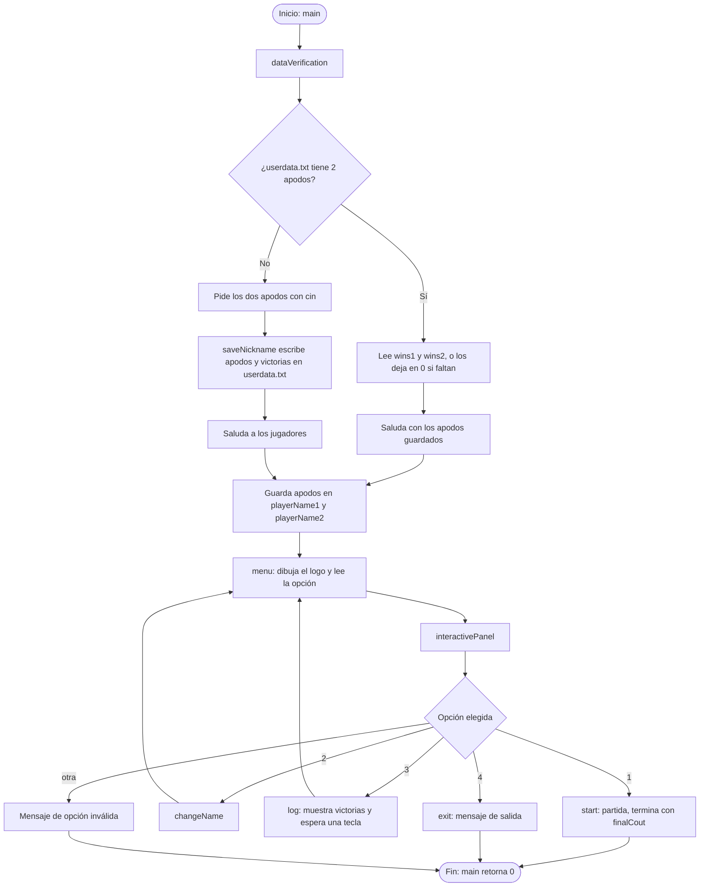
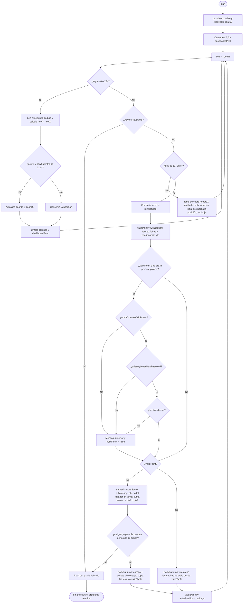
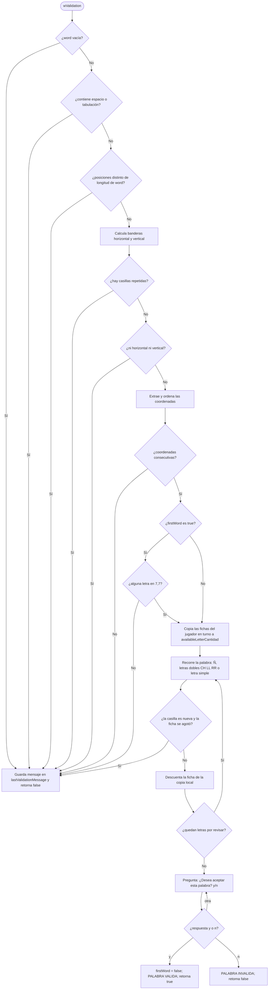
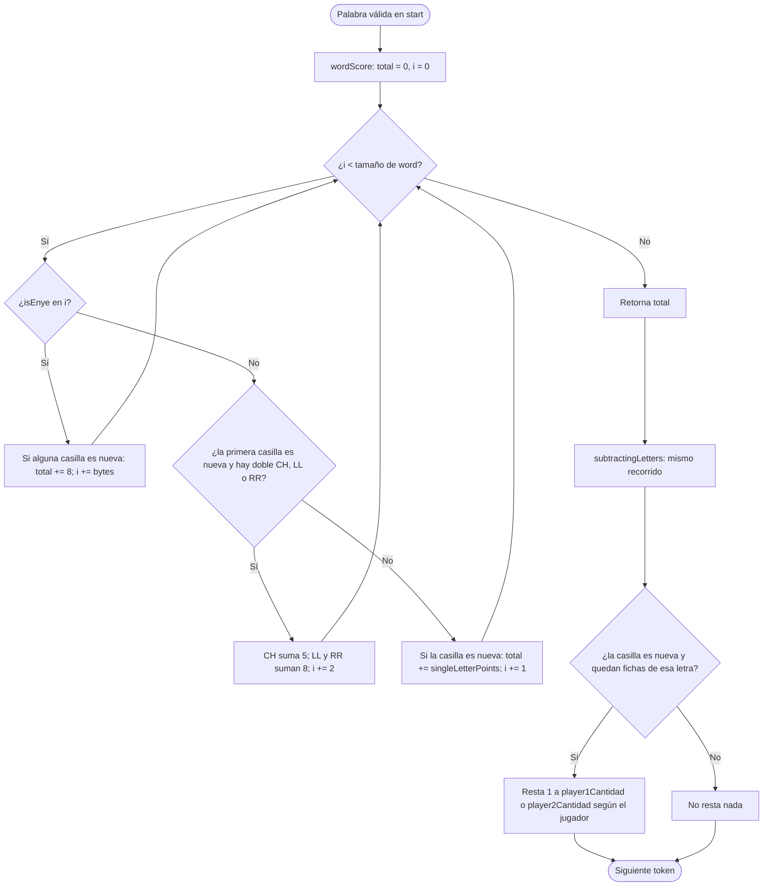
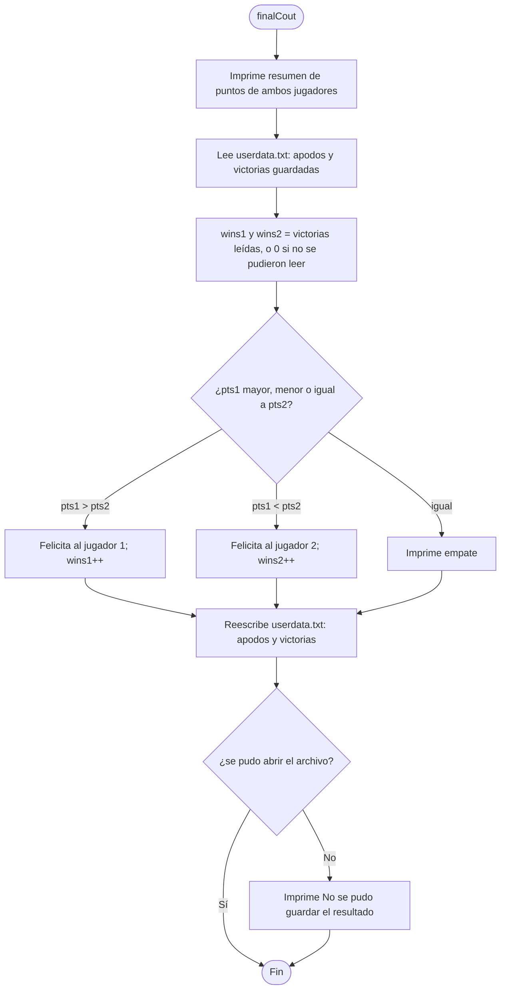

# Juego de Palabras en C++ (estilo Scrabble) — Documentación técnica

Juego de consola para **dos jugadores** escrito en C++ sobre un tablero de **15 x 15** casillas. Los jugadores se turnan para escribir palabras con el teclado, moviendo un cursor con las flechas. El programa valida la forma de la palabra (línea recta, casillas consecutivas, conexión con palabras anteriores, fichas disponibles), pide una **confirmación manual** (`y`/`n`) de que la palabra existe, calcula el puntaje según el valor de cada letra y lleva el control de fichas y de victorias.

> **Plataforma:** solo Windows. El código usa `conio.h` (`_getch`, `getch`) y `windows.h` (`GetConsoleScreenBufferInfo`).

---

## Tabla de contenido

1. [Resumen rápido](#1-resumen-rápido)
2. [Compilación y ejecución](#2-compilación-y-ejecución)
3. [Estructura del proyecto](#3-estructura-del-proyecto)
4. [Cómo se juega](#4-cómo-se-juega)
5. [Arquitectura general](#5-arquitectura-general)
6. [Diagramas de flujo](#6-diagramas-de-flujo)
7. [Librerías incluidas](#7-librerías-incluidas)
8. [Variables globales](#8-variables-globales)
9. [Referencia de funciones](#9-referencia-de-funciones)
10. [Modelo de datos del tablero (`table` vs `validTable`)](#10-modelo-de-datos-del-tablero-table-vs-validtable)
11. [Reglas de validación en orden](#11-reglas-de-validación-en-orden)
12. [Limitaciones y errores conocidos](#12-limitaciones-y-errores-conocidos)
13. [Mejoras sugeridas](#13-mejoras-sugeridas)
14. [Cambios respecto al README anterior](#14-cambios-respecto-al-readme-anterior)

---

## 1. Resumen rápido

| Aspecto | Detalle |
| --- | --- |
| Lenguaje | C++ (un solo archivo: `main.cpp`, ~860 líneas) |
| Jugadores | 2 activos por partida; cada nickname conserva sus victorias y puntos acumulados en `userdata.txt` |
| Tablero | `15 x 15`, cursor inicial en la casilla central `[7][7]` |
| Entrada | Flechas (mover), letras (escribir), `Enter` (validar), `y`/`n` (confirmar palabra), `.` (terminar la partida) |
| Turnos | Sí, alternan J1 / J2 después de cada `Enter` |
| Fichas | 98 por jugador, descontadas al jugar letras nuevas; panel lateral con las fichas que quedan |
| Puntaje | Por valor de letra (1 a 10 puntos), contando solo las letras **nuevas** de la palabra |
| Fin de partida | Cuando se presiona `.` o cuando a algún jugador le quedan menos de 10 fichas |
| Validación de existencia | **Manual**: el programa pregunta `y/n` (ya no hay diccionario interno) |
| Persistencia | Nicknames activos, victorias y puntos acumulados por perfil; se conserva el historial al cambiar usuarios |
| Registro de resultados | Opción 3 del menú: muestra las victorias y puntos acumulados de todos los nicknames guardados |

---

## 2. Compilación y ejecución

Con `g++` (MinGW) en Windows:

```
g++ main.cpp -o juego
juego.exe
```

Notas del entorno:

- El juego limpia la pantalla con la secuencia ANSI `\033[2J\033[1;1H`. En **Windows Terminal** funciona directamente; en consolas antiguas (`cmd.exe` sin soporte ANSI) puede imprimir caracteres extraños.
- Los bloques del tablero son los caracteres del código `219` (`█`) y el cursor es el `206` (`╬`) de la página de códigos 437/850 de la consola. Con otra página de códigos se verán otros símbolos.
- La `Ñ` se reconoce tanto en UTF-8 como en las codificaciones de un solo byte de la consola (CP437/CP850/CP1252); ver [`isEnye`](#bool-isenyeconst-string-word-size_t-i-size_t-bytes).

---

## 3. Estructura del proyecto

```
scrabbleProyecto/
├── main.cpp        # Todo el código del juego
├── README.md       # Esta documentación
├── LICENSE
├── .gitignore
└── userdata.txt    # Se crea en la primera ejecución y conserva todos los perfiles
```

`userdata.txt` guarda los dos nicknames activos y el registro de victorias y puntos acumulados de todos los nicknames usados:

```
SCRABBLE_USERS_V2
<nickname activo del jugador 1>
<nickname activo del jugador 2>
<cantidad de perfiles>
<nickname> <victorias> <puntos acumulados>
...
```

Al cambiar los nombres desde el menú se cambia de usuarios: los perfiles previos se conservan y los nuevos comienzan con `0` victorias y `0` puntos. Si se vuelve a usar un nickname guardado, recupera sus estadísticas. Al finalizar una partida se suman los puntos obtenidos por cada jugador a su perfil. La opción 3 muestra el registro de todos los perfiles. Los formatos anteriores se migran automáticamente al nuevo formato; los puntos de partidas anteriores no disponibles en esos archivos comienzan en `0`.

---

## 4. Cómo se juega

1. Al abrir el programa por primera vez se piden los nicknames de los dos jugadores; se guardan como los usuarios activos.
2. La opción `2` del menú permite cambiar los dos usuarios activos. Cada nickname conserva sus victorias y puntos acumulados; los nicknames nuevos comienzan con `0`.
3. La opción `3` muestra las victorias y los puntos acumulados de todos los perfiles guardados.
4. En el menú se escribe `1` para jugar.
5. Se dibuja el tablero con filas y columnas numeradas del 1 al 15, el cursor (`╬`) en el centro y, a la derecha, el panel **FICHAS QUE QUEDAN** del jugador en turno, agrupado por puntos.
6. El jugador en turno **mueve el cursor** con las flechas y **escribe una letra por casilla** hasta formar su palabra.
7. Con **Enter** se valida la palabra:
   - Se comprueba la forma de la palabra y que el jugador tenga fichas suficientes.
   - El programa muestra `Palabra: <palabra> ¿Desea aceptar esta palabra? y/n:`. Se responde `y` (la palabra existe) o `n` (se rechaza). Cualquier otra respuesta vuelve a preguntar.
   - Si es aceptada y cumple las reglas de conexión, se suman los puntos de las letras nuevas, se descuentan las fichas usadas y las letras quedan fijas en el tablero. El mensaje muestra `PALABRA VALIDA, FELICIDADES (+N puntos)`.
   - Si no es válida: se muestra el motivo, las letras escritas se borran y el turno pasa igualmente al otro jugador.
8. La partida termina cuando:
   - se presiona la tecla **punto (`.`)**, o
   - después de una palabra válida a algún jugador le quedan **menos de 10 fichas** en total.
9. Al terminar se muestra el resumen de puntos, se anuncia al ganador (o empate), se suman los puntos de la partida a cada perfil y se suma la victoria al perfil ganador en `userdata.txt`.

El encabezado del tablero muestra siempre los apodos, de quién es el turno, los puntos de cada jugador y el último mensaje de validación.

**Valor de las letras**

| Puntos | Letras |
| --- | --- |
| 1 | A, E, I, L, N, O, R, S, T, U |
| 2 | D, G |
| 3 | B, C, M, P |
| 4 | F, H, V, Y |
| 5 | CH, Q |
| 8 | J, LL, Ñ, RR, X |
| 10 | Z |

---

## 5. Arquitectura general

El programa es una **cadena de llamadas** que baja desde `main` hasta el ciclo del juego:

```
main
 ├── dataVerification ── saveNickname
 └── menu
      └── interactivePanel
           ├── (1) start ── dashboard, dashboardPrint, wValidation,
           │                 wordCrossesValidBoard, existingLetterMatchesWord,
           │                 hasNewLetter, wordScore, subtractingLetters, finalCout
           ├── (2) changeName ── saveNickname  → vuelve a menu()
           ├── (3) log                         → vuelve a menu()
           ├── (4) exit
           └── otra → mensaje de opción inválida

wValidation ── isEnye, findLetterIndex
wordScore ── isEnye, singleLetterPoints
subtractingLetters ── isEnye, findLetterIndex
dashboardPrint (panel de fichas)
```

Puntos clave de diseño:

- **No existe un ciclo de menú propiamente dicho.** Después de la opción 1, 4 o una opción inválida, las funciones retornan en cadena y el programa termina. Las opciones 2 y 3 vuelven a mostrar el menú llamando a `menu()` de nuevo (recursión).
- **Estado global.** Tablero, turno, puntos, victorias, fichas, nombres y último mensaje viven en variables globales; `start()` solo conserva localmente la palabra en construcción, sus posiciones y la bandera de primera palabra.
- **Dos tableros.** `table` es el tablero "de trabajo" (lo que el jugador va escribiendo) y `validTable` es el tablero "confirmado" (lo que ya fue aceptado). Ver [sección 10](#10-modelo-de-datos-del-tablero-table-vs-validtable). Las funciones de puntaje y de descuento de fichas usan `validTable` para saber qué letras son **nuevas** (casilla en `219`) y cuáles ya estaban.
- **Fichas por jugador.** `player1Cantidad` y `player2Cantidad` llevan el inventario de cada jugador (en el mismo orden que `words`). `wValidation` comprueba que alcancen y `subtractingLetters` las descuenta.
- **Validación en dos capas.** `wValidation` revisa forma, fichas y confirmación manual; después `start()` aplica las reglas de conexión con el tablero.

---

## 6. Diagramas de flujo

Los diagramas están en [Mermaid](https://mermaid.js.org/), que GitHub renderiza automáticamente.

### 6.1 Flujo general del programa



### 6.2 Ciclo principal de la partida (`start`)



### 6.3 Validación de la palabra (`wValidation`)



### 6.4 Construcción del logo del menú (`menu`)


### 6.5 Puntaje y descuento de fichas (`wordScore` y `subtractingLetters`)

Ambas funciones recorren la palabra con la misma lógica de "token" (Ñ, letra doble o letra simple) y solo cuentan las casillas **nuevas** (`validTable == 219`).



### 6.6 Fin de partida (`finalCout`)



---

## 7. Librerías incluidas

| Librería | Para qué se usa en el código |
| --- | --- |
| `<iostream>` | `cout` / `cin`: mostrar texto y leer apodos, opciones del menú y la confirmación `y/n` |
| `<fstream>` | `ifstream` / `ofstream`: leer y escribir `userdata.txt` (apodos y victorias) |
| `<string>` | `string` para apodos, palabra en construcción y mensajes; `to_string` para los números del panel y del puntaje |
| `<conio.h>` | `_getch()`: leer una tecla al instante sin esperar Enter; `getch()` en `log` para esperar una tecla (solo Windows) |
| `<cctype>` | `tolower()` / `toupper()` en `existingLetterMatchesWord`, `findLetterIndex`, `singleLetterPoints`, `wordScore`, `subtractingLetters` y `wValidation` |
| `<vector>` | `vector<pair<int,int>>` para las posiciones de las letras; `vector<int>` para las coordenadas en `wValidation`; `vector<string>` para las líneas del panel de fichas |
| `<algorithm>` | `sort()` para ordenar coordenadas y comprobar que sean consecutivas |
| `<windows.h>` | `CONSOLE_SCREEN_BUFFER_INFO`, `GetStdHandle`, `GetConsoleScreenBufferInfo` para medir el ancho de la consola |

`using namespace std;` evita escribir el prefijo `std::`.

---

## 8. Variables globales

| Variable | Tipo | Valor inicial | Descripción |
| --- | --- | --- | --- |
| `table` | `char[15][15]` | sin inicializar (se llena en `dashboard`) | Tablero de trabajo: muestra lo que se está escribiendo en este momento, más las letras ya confirmadas. Cada casilla vacía contiene el código `219`. |
| `validTable` | `unsigned char[15][15]` | sin inicializar (se llena en `dashboard`) | Tablero confirmado: solo las letras de palabras ya aceptadas. Sirve para saber qué casillas están ocupadas, qué letras de una palabra son **nuevas** (para puntaje y fichas) y para restaurar `table` cuando una palabra falla. Es `unsigned char` para poder comparar sin problemas con `219`. |
| `turn` | `int` | `1` | Jugador en turno (1 o 2). Alterna tras cada Enter (salvo cuando la partida termina). |
| `pts1` | `int` | `0` | Puntos del jugador 1 en la partida actual. |
| `pts2` | `int` | `0` | Puntos del jugador 2 en la partida actual. |
| `wins1` | `int` | `0` | Victorias acumuladas del jugador 1. Se cargan de `userdata.txt` en `dataVerification` y se actualizan en `finalCout`. |
| `wins2` | `int` | `0` | Victorias acumuladas del jugador 2. |
| `playerName1` | `string` | `"Jugador 1"` | Apodo del jugador 1 (lo actualizan `dataVerification` y `changeName`). |
| `playerName2` | `string` | `"Jugador 2"` | Apodo del jugador 2. |
| `lastValidationMessage` | `string` | `""` | Último mensaje de validación; `dashboardPrint` lo muestra bajo el encabezado si no está vacío. |
| `words` | `string[28]` | A, E, I, L, N, O, R, S, T, U, D, G, B, C, M, P, F, H, V, Y, CH, Q, J, LL, Ñ, RR, X, Z | Alfabeto de fichas del juego. Su posición es el índice que comparten `player1Cantidad` y `player2Cantidad`, y lo usan `findLetterIndex` y el panel de fichas. No incluye K ni W. |
| `WORD_COUNT` | `const int` | `sizeof(words) / sizeof(words[0])` = `28` | Cantidad de elementos de `words` (y de los arreglos de fichas). Se usa como límite de los ciclos y como tamaño de `availableLetterCantidad`. |
| `player1Cantidad` | `int[28]` | 12, 12, 6, 4, 5, 9, 5, 6, 4, 5, 5, 2, 2, 4, 2, 2, 1, 2, 1, 1, 1, 1, 1, 1, 1, 1, 1, 1 | Fichas que le quedan al jugador 1 por letra (mismo orden que `words`; empiezan sumando 98). `subtractingLetters` las descuenta y `wValidation` las consulta. |
| `player2Cantidad` | `int[28]` | igual que `player1Cantidad` | Fichas que le quedan al jugador 2 por letra. |

> Los valores `219` y `206` son "números mágicos" (bloque `█` y cursor `╬`). Conviene reemplazarlos por constantes con nombre (ver [mejoras](#13-mejoras-sugeridas)).

---

## 9. Referencia de funciones

### Índice

| Función | Línea | Propósito |
| --- | --- | --- |
| `terminalWidth` | 31 | Ancho de la consola |
| `main` | 63 | Punto de entrada |
| `saveNickname` | 70 | Guarda apodos y victorias en archivo |
| `dataVerification` | 82 | Carga o pide apodos; carga victorias |
| `menu` | 108 | Logo, opciones y lectura de opción |
| `start` | 152 | Ciclo de la partida |
| `changeName` | 288 | Cambia apodos |
| `log` | 302 | Muestra las victorias acumuladas |
| `exit` | 333 | Mensaje de salida |
| `interactivePanel` | 337 | Despachador de opciones |
| `dashboard` | 357 | Inicializa los tableros |
| `dashboardPrint` | 366 | Dibuja encabezado, tablero y panel de fichas |
| `findLetterIndex` | 411 | Índice de una letra en `words` |
| `subtractingLetters` | 425 | Descuenta fichas del jugador |
| `singleLetterPoints` | 495 | Valor de una letra simple |
| `isEnye` | 517 | Detecta la Ñ en distintas codificaciones |
| `hasNewLetter` | 538 | La palabra coloca al menos una letra nueva |
| `wordScore` | 547 | Calcula el puntaje de la palabra |
| `wordCrossesValidBoard` | 605 | La palabra toca o cruza letras confirmadas |
| `existingLetterMatchesWord` | 629 | Letras reutilizadas coinciden |
| `wValidation` | 645 | Reglas, fichas y confirmación manual |
| `finalCout` | 820 | Fin de partida, ganador y victorias |

*(Las líneas corresponden a la versión actual de `main.cpp`.)*

---

### `int terminalWidth()`

Devuelve el ancho útil de la consola, en caracteres.

- **Variables locales:** `csbi` (`CONSOLE_SCREEN_BUFFER_INFO`): estructura de la API de Windows que se llena con la información de la consola.
- **Funcionamiento:** llama a `GetConsoleScreenBufferInfo` sobre la salida estándar (`GetStdHandle(STD_OUTPUT_HANDLE)`). Si tiene éxito, calcula `Right - Left + 1` de la ventana visible. Si falla (por ejemplo, la salida está redirigida), devuelve `80`.
- **Usada por:** `menu`.

### `int main()`

Punto de entrada.

- **Variables locales:** `nickname1`, `nickname2` (`string`): reciben los apodos desde `dataVerification`. Después de eso no se vuelven a usar; el resto del programa lee `playerName1` y `playerName2`.
- **Funcionamiento:** llama a `dataVerification` y luego a `menu`. Retorna `0`.

### `void saveNickname(const string& nickname1, const string& nickname2)`

Escribe los apodos **y las victorias** en `userdata.txt`.

- **Parámetros:** `nickname1`, `nickname2`: apodos a guardar (por referencia constante, sin copiarlos).
- **Variables locales:** `userFile` (`ofstream`): flujo de salida al archivo.
- **Funcionamiento:** abre `userdata.txt` (lo crea o **lo sobrescribe**), escribe `nickname1`, `nickname2`, `wins1` y `wins2`, cada uno en su línea, y cierra. Si no puede abrirlo, imprime `No se pudo guardar el nickname`.
- **Efectos secundarios:** modifica el archivo `userdata.txt`. Como escribe las variables globales `wins1` y `wins2`, al cambiar los apodos las victorias acumuladas se conservan.

### `void dataVerification(string& nickname1, string& nickname2)`

Decide si pedir los apodos o cargarlos del archivo, y carga las victorias.

- **Parámetros:** `nickname1`, `nickname2` (por referencia): salida; se llenan con los apodos.
- **Variables locales:** `userFile` (`ifstream`): flujo de entrada de `userdata.txt`.
- **Funcionamiento:**
  1. Intenta leer dos palabras con `userFile >> nickname1 && userFile >> nickname2`.
  2. Si ambas lecturas funcionan: intenta leer `wins1` y `wins2`; si no hay números (archivo con formato antiguo), los deja en `0`. Saluda con `Bienvenidos nuevamente`.
  3. Si no (archivo inexistente o incompleto): pide los apodos por `cin`, los guarda con `saveNickname` (con las victorias en `0`) y saluda.
  4. En ambos casos copia los apodos a las globales `playerName1` y `playerName2`.
- **Nota:** `>>` y `cin >>` leen **hasta el primer espacio**, así que los apodos no pueden tener espacios.

### `int menu()`

Dibuja el logo "MENU", muestra las opciones, lee la elección y la envía a `interactivePanel`.

- **Variables locales:**
  - `option` (`int`): opción escrita por el usuario.
  - `letters[4][5]` (`const string`): mapa de bits de las letras **M, E, N, U**; cada letra son 5 filas de 5 caracteres (`'1'` = pintar, `'0'` = vacío).
  - `symbols[4]` (`const char`): `'#'`, `'@'`, `'%'`, `'&'`; símbolo con que se dibuja cada letra.
  - `width` (`const int`): `terminalWidth() - 1`, para evitar un salto de línea extra al llenar la fila completa.
  - `totalCols` (`const int`): `4 * 5 + 3 = 23`; columnas del bitmap original (4 letras de 5 columnas más 3 espacios separadores).
  - `rowRepeat` (`int`): veces que se repite cada fila para que el logo mantenga proporción (`(width / totalCols) / 2`, mínimo 1; el `/ 2` compensa que un carácter es más alto que ancho).
  - `row` (`int`, 0–4): fila del bitmap.
  - `line` (`string`): línea de texto que se va armando.
  - `x` (`int`): columna de pantalla (0 a `width - 1`).
  - `src` (`int`): columna del bitmap original equivalente, `x * totalCols / width` (escalado horizontal).
  - `letter` (`int`): índice de la letra, `src / 6` (cada letra ocupa 5 columnas + 1 de separación).
  - `col` (`int`): columna dentro de la letra, `src % 6` (la columna 5 es el separador y nunca pinta).
  - `r` (`int`): contador de repeticiones de fila.
- **Funcionamiento:** imprime una línea de `=`, genera el logo ampliado al ancho de la consola, imprime otra línea de `=`, muestra las cuatro opciones, lee `option` con `cin` y llama a `interactivePanel(option)`.
- **Retorno:** `option` (el valor de retorno no se usa en ninguna parte).
- **Nota:** si el usuario escribe algo que no es un número, `cin` falla y `option` queda en `0`, lo que cae en el caso de opción inválida.

### `void interactivePanel(int x)`

Despachador del menú (un `switch`).

- **Parámetros:** `x`: opción elegida.
- **Casos:**
  - `1` → `start()`.
  - `2` → `changeName()` y después `menu()` (recursión: vuelve a mostrar el menú).
  - `3` → `log()` (que a su vez vuelve a `menu()`).
  - `4` → `exit()`.
  - otro → imprime `ESA OPCION ES INVALIDA(x)`.

### `string changeName()`

Pide nuevos apodos y los reemplaza.

- **Variables locales:** `newNickname1`, `newNickname2` (`string`).
- **Funcionamiento:** lee ambos con `cin`, los guarda con `saveNickname` (sobrescribe el archivo conservando `wins1` y `wins2`) y actualiza `playerName1` y `playerName2`.
- **Retorno:** `newNickname1` (el valor devuelto no se usa).

### `void log()`

Registro de resultados (opción 3): muestra las victorias acumuladas de cada jugador.

- **Variables locales:** `userFile` (`ifstream`): lectura de `userdata.txt`; `name1`, `name2` (`string`): apodos leídos; `victories1`, `victories2` (`int`, inician en `0`): victorias leídas.
- **Funcionamiento:**
  1. Abre `userdata.txt`. Si no puede, imprime `No se pudo cargar los datos.`, espera una tecla (`getch()`), llama a `menu()` y retorna.
  2. Lee `name1 name2 victories1 victories2`. Si funciona, limpia la pantalla (secuencia ANSI) y muestra `VICTORIAS DE LOS JUGADORES` con una línea por jugador (`<apodo>: N victorias`) y la indicación `(Presiona cualquier tecla para volver al menu)`. Si falla, imprime `No se pudieron leer las victorias.`
  3. Cierra el archivo, espera una tecla y vuelve a `menu()` (recursión).
- **Nota:** lee del **archivo**, no de `wins1`/`wins2`; solo refleja partidas ya terminadas y guardadas por `finalCout`.

### `void exit()`

Solo imprime `SALIENDO DEL PROGRAMA...`. **No termina el proceso por sí misma**: el programa acaba porque las funciones retornan hasta `main`. Además comparte nombre con `exit(int)` de la librería estándar (sobrecarga), y `log()` con `log(double)` de `<cmath>`; conviene renombrarlas.

### `void dashboard()`

Inicializa ambos tableros.

- **Variables locales:** `i`, `j` (`int`): índices de fila y columna.
- **Funcionamiento:** recorre las 225 casillas y asigna `219` (bloque sólido) tanto en `table` como en `validTable`. `219` significa "casilla vacía".

### `void dashboardPrint(int cursorY, int cursorX)`

Dibuja el encabezado, el tablero y, a su derecha, el panel de fichas.

- **Parámetros:** `cursorY`, `cursorX`: fila y columna del cursor.
- **Variables locales:**
  - `panelLines` (`vector<string>`): líneas de texto del panel lateral.
  - `groupStarts[]` = `{0, 10, 12, 16, 20, 22, 27}` y `groupEnds[]` = `{10, 12, 16, 20, 22, 27, 28}` (`const int`): rango de índices de `words` de cada grupo de puntaje (fin exclusivo).
  - `groupPoints[]` (`const string`): etiqueta de cada grupo: `"1 punto"`, `"2 puntos"`, `"3 puntos"`, `"4 puntos"`, `"5 puntos"`, `"8 puntos"`, `"10 puntos"`.
  - `group` (`int`): grupo actual (0 a 6).
  - `line` (`string`): línea del grupo, con formato `1 punto: A x12, E x12, ...`.
  - `remaining` (`int`): fichas que le quedan de la letra `i` al jugador en turno.
  - `i`, `j` (`int`): índices de los ciclos.
- **Funcionamiento:**
  1. Imprime `Bienvenidos, <J1> y <J2>`.
  2. Imprime `Turno: J<turn> | Puntos J1: <pts1> | Puntos J2: <pts2>`.
  3. Si `lastValidationMessage` no está vacío, lo imprime.
  4. Arma el panel `FICHAS QUE QUEDAN`: título, `Jugador N: <apodo>` del jugador **en turno**, una línea separadora y siete líneas de fichas por grupo de puntaje (10 líneas en total).
  5. Recorre el tablero: en `[cursorY][cursorX]` pinta el carácter `206` (cursor) y en las demás casillas el contenido de `table[i][j]`. Cada casilla va entre espacios; en las primeras 10 filas se agrega `   |   ` y la línea correspondiente del panel; cada fila se separa con una línea en blanco.
- **Nota:** como el cursor tapa la casilla donde está, la letra de esa casilla no se ve mientras el cursor esté encima. El panel solo muestra las fichas del jugador al que le toca.

### `void start()`

Ciclo de la partida: lee teclas, mueve el cursor, escribe letras, valida palabras, puntúa y detecta el fin de la partida.

- **Constantes locales:** `KEY_UP = 72`, `KEY_DOWN = 80`, `KEY_LEFT = 75`, `KEY_RIGHT = 77`: segundo código que devuelve `_getch()` para cada flecha.
- **Variables locales:**
  - `word` (`string`): palabra en construcción (en el orden en que se escribieron las letras).
  - `letterPositions` (`vector<pair<int,int>>`): posición `(fila, columna)` de cada letra de `word`, en el mismo orden.
  - `firstWord` (`bool`): `true` hasta que se acepte la primera palabra. (Se asigna `true` dos veces seguidas; una es redundante.)
  - `coordX`, `coordY` (`int`): columna y fila del cursor; empiezan en `7`.
  - `key` (`int`): tecla leída con `_getch()`.
  - `newY`, `newX` (`int`): posición candidata al mover el cursor.
  - `wasFirstWord` (`bool`): copia de `firstWord` antes de validar, porque `wValidation` la puede cambiar.
  - `validPoint` (`bool`): resultado final de la validación completa.
  - `earned` (`int`): puntos obtenidos por la palabra (resultado de `wordScore`).
  - `totalCardsUser1`, `totalCardsUser2` (`int`): total de fichas que le quedan a cada jugador (suma de `player1Cantidad` / `player2Cantidad`).
  - `i` (`int`, dentro del `for`): índice para sumar las fichas.
  - `c` (`char&`, dentro del `for`): cada carácter de `word` al pasarlo a minúsculas.
  - `position` (`const auto&`, dentro de los `for`): cada par de `letterPositions`.
- **Funcionamiento por tipo de tecla:**
  - **`0` o `224`:** prefijo de tecla especial. Se lee un segundo `_getch()`; según su valor se ajusta `newY`/`newX`. Si la nueva posición está dentro de `0..14` se acepta. Luego limpia la pantalla (`\033[2J\033[1;1H`) y redibuja.
  - **`46` (`.`):** llama a `finalCout()` (resumen, ganador y victorias) y sale del ciclo; al volver a `main` el programa termina.
  - **`13` (Enter):** valida la palabra (ver abajo).
  - **Cualquier otra tecla:** `table[coordY][coordX]` recibe la tecla, se agrega a `word`, se guarda `(coordY, coordX)` en `letterPositions` y se redibuja.
- **Al presionar Enter:**
  1. Se borra `lastValidationMessage`.
  2. `word` se convierte a minúsculas (solo `A`–`Z`).
  3. Se llama `wValidation(word, letterPositions, firstWord)` (forma, fichas y confirmación `y/n`).
  4. Si fue válida **y no era la primera palabra**, se aplican tres comprobaciones extra, en este orden: `wordCrossesValidBoard`, `existingLetterMatchesWord` y `hasNewLetter`. Si alguna falla, se pone el mensaje correspondiente y `validPoint = false`.
  5. **Si es válida:**
     1. `earned = wordScore(word, letterPositions)`.
     2. `subtractingLetters(word, letterPositions, turn)` descuenta las fichas (se hace **antes** de copiar a `validTable`, porque necesita distinguir las casillas nuevas).
     3. Suma `earned` a `pts1` (si `turn == 1`) o `pts2`.
     4. Suma las fichas restantes de cada jugador; si a **alguno le quedan menos de 10**, llama a `finalCout()` y sale del ciclo.
     5. En caso contrario, cambia el turno, agrega ` (+N puntos)` al mensaje y copia cada letra de `table` a `validTable` (confirma las letras).
  6. **Si no es válida:** cambia el turno igualmente y restaura cada casilla de `letterPositions` en `table` con su valor de `validTable` (las casillas vacías vuelven a `219` y las ya confirmadas conservan su letra).
  7. Vacía `word` y `letterPositions`, limpia la pantalla y redibuja.
- **Importante:** el ciclo no termina después de validar una palabra; sigue hasta presionar `.` o hasta que se agoten las fichas según la regla de fin de partida.

### `int findLetterIndex(const string& letter)`

Busca una letra en el arreglo `words` y devuelve su índice.

- **Parámetros:** `letter`: letra o ficha a buscar (`"A"`, `"CH"`, `"Ñ"`...).
- **Variables locales:** `upperLetter` (`string`): copia en mayúsculas; `c` (`char&`): cada carácter al pasarlo a mayúscula; `i` (`int`): índice del ciclo.
- **Funcionamiento:** pasa `letter` a mayúsculas con `toupper` y recorre `words` de `0` a `WORD_COUNT - 1`; devuelve el índice de la primera coincidencia.
- **Retorno:** el índice, o `-1` si la letra no está en `words` (por ejemplo `K`, `W`, números o símbolos).
- **Usada por:** `wValidation` y `subtractingLetters`.

### `void subtractingLetters(const string& word, const vector<pair<int,int>>& letterPositions, int player)`

Descuenta del inventario del jugador las fichas de las letras **nuevas** de la palabra.

- **Parámetros:** `word` (en minúsculas); `letterPositions` (posiciones en el mismo orden); `player` (`1` o `2`).
- **Variables locales:** `wordIndex` (`size_t`): posición actual dentro de `word`; `bytes` (`size_t`): bytes que ocupa el token actual (1 por defecto); `token` (`string`): ficha detectada (`"Ñ"`, `"CH"`, `"LL"`, `"RR"`); `positionIndex` (`int`): índice en `letterPositions` (igual a `wordIndex`); `position` (`const auto&`): posición `(fila, columna)` de la letra; `letterIndex` (`int`): índice de la ficha en `words`; `remaining` (`int&`): referencia a la cantidad del jugador, que se decrementa; `first`, `second` (`char`): dos letras consecutivas en mayúscula para detectar dobles; `current` (`char`): letra simple en mayúscula.
- **Funcionamiento:** recorre la palabra token por token, con este orden de prioridad:
  1. **Ñ** (`isEnye`): token `"Ñ"`, avanza `bytes`.
  2. **Letra doble** `CH`, `LL` o `RR` (si hay al menos otra letra y otra posición): token de dos letras, avanza 2.
  3. **Letra simple**: avanza 1.
  En cada caso, solo descuenta si la casilla del token está libre en `validTable` (`== 219`, o sea, es una letra nueva), la ficha existe en `words` y quedan fichas (`> 0`). Las letras que ya estaban en el tablero **no consumen fichas**.
- **Efectos secundarios:** modifica `player1Cantidad` o `player2Cantidad`.

### `int singleLetterPoints(char letter)`

Valor en puntos de una letra simple.

- **Parámetros:** `letter`: letra (mayúscula o minúscula; se normaliza con `toupper`).
- **Retorno (`switch`):**

| Puntos | Letras |
| --- | --- |
| 1 | A, E, I, L, N, O, R, S, T, U |
| 2 | D, G |
| 3 | B, C, M, P |
| 4 | F, H, V, Y |
| 5 | Q |
| 8 | J, X |
| 10 | Z |
| 0 | cualquier otra (K, W, números, símbolos...) |

- **Nota:** los valores de `CH` (5), `LL` (8), `RR` (8) y `Ñ` (8) se asignan en `wordScore`, no aquí.

### `bool isEnye(const string& word, size_t i, size_t& bytes)`

Detecta si en la posición `i` de `word` hay una `Ñ` o `ñ`, sin importar la codificación.

- **Parámetros:** `word`; `i` (posición a revisar); `bytes` (por referencia, **salida**): cantidad de bytes que ocupa la Ñ.
- **Variables locales:** `current` (`unsigned char`): byte en `word[i]`; `next` (`unsigned char`): byte siguiente.
- **Funcionamiento:**
  - **UTF-8:** `0xC3` seguido de `0x91` (Ñ) o `0xB1` (ñ) → `bytes = 2`, retorna `true`.
  - **Un solo byte** de la consola (CP437/CP850/CP1252): `0xA5`, `0xA4`, `0xD1` o `0xF1` → `bytes = 1`, retorna `true`.
  - En otro caso retorna `false` y no modifica `bytes` (quien llama lo inicializa en 1).
- **Usada por:** `wValidation`, `wordScore` y `subtractingLetters`.

### `bool hasNewLetter(const vector<pair<int,int>>& letterPositions)`

Comprueba que la palabra coloque **al menos una letra nueva**.

- **Parámetros:** `letterPositions`: posiciones de la palabra candidata.
- **Variables locales:** `position` (`const auto&`): cada posición.
- **Funcionamiento:** devuelve `true` en cuanto encuentra una casilla libre en `validTable` (`== 219`); si todas ya estaban ocupadas, devuelve `false`. Evita puntuar de nuevo una palabra que ya está en el tablero.
- **Usada por:** `start` (solo para palabras que no son la primera).

### `int wordScore(const string& word, const vector<pair<int,int>>& letterPositions)`

Calcula los puntos de una palabra aceptada, contando **solo las letras nuevas**.

- **Parámetros:** `word` (en minúsculas); `letterPositions`.
- **Variables locales:** `total` (`int`): acumulador; `i` (`size_t`): posición actual en `word`; `bytes` (`size_t`): bytes del token; `anyNew` (`bool`): indica si alguna casilla de la Ñ es nueva; `k` (`size_t`): índice para recorrer los bytes de la Ñ; `firstIsNew` (`bool`): si la casilla de la letra actual es nueva; `current`, `next` (`char`): letra actual y siguiente en mayúscula.
- **Funcionamiento:**
  1. **Ñ** (`isEnye`): suma `8` si alguna de sus casillas es nueva y avanza `bytes`.
  2. **Letra doble** (solo si la primera casilla es nueva y hay una letra siguiente): `CH` suma `5`, `LL` suma `8`, `RR` suma `8`; avanza 2. Las dobles "se validan en su primera letra".
  3. **Letra simple:** si su casilla es nueva, suma `singleLetterPoints(current)`; avanza 1.
- **Retorno:** el total de puntos. No hay casillas de bonificación ni se puntúan palabras secundarias.

### `bool wordCrossesValidBoard(const vector<pair<int,int>>& letterPositions)`

Comprueba que una palabra nueva (no la primera) se **conecte** con lo ya confirmado.

- **Parámetros:** `letterPositions`: posiciones de la palabra candidata.
- **Variables locales:** `position`, `y`, `x` (posición actual); `dy[]` = `{-1, 1, 0, 0}` y `dx[]` = `{0, 0, -1, 1}` (desplazamientos arriba, abajo, izquierda, derecha); `i` (índice de dirección); `adjacentY`, `adjacentX` (casilla vecina).
- **Funcionamiento:** para cada letra de la palabra devuelve `true` si
  - esa casilla ya está ocupada en `validTable` (la palabra **cruza** una letra existente), o
  - alguna de sus 4 casillas vecinas (con límites controlados) está ocupada en `validTable` (la palabra **toca** una letra existente).
  Si ninguna letra cumple, devuelve `false`.

### `bool existingLetterMatchesWord(const string& word, const vector<pair<int,int>>& letterPositions)`

Comprueba que, donde la palabra pasa por una casilla ya confirmada, la letra escrita **sea la misma** que la ya existente.

- **Parámetros:** `word` (palabra en minúsculas); `letterPositions` (posiciones, en el mismo orden).
- **Variables locales:** `i` (índice); `y`, `x` (posición de la letra `i`); `candidate` (letra escrita en `table`, en minúscula); `validated` (letra en `validTable`, en minúscula); `expected` (`word[i]`, en minúscula).
- **Funcionamiento:** para cada letra cuya casilla está ocupada en `validTable`, exige `candidate == validated == expected`. Al primer desacuerdo devuelve `false`; si todas coinciden, devuelve `true`. El uso de `tolower` evita diferencias por mayúsculas, y el `unsigned char` en el argumento evita comportamiento indefinido con caracteres extendidos.

### `bool wValidation(string word, const vector<pair<int,int>>& letterPositions, bool& firstWord)`

Aplica las reglas de forma de la palabra, comprueba las fichas del jugador y pide la confirmación manual. **Ya no usa diccionario interno.**

- **Parámetros:**
  - `word`: palabra a validar (copia).
  - `letterPositions`: posiciones de cada letra.
  - `firstWord`: bandera por referencia; si el jugador confirma la palabra se pone en `false`.
- **Variables locales:**
  - `horizontal`, `vertical` (`bool`): empiezan en `true`; se vuelven `false` si alguna posición cambia de fila (rompe horizontal) o de columna (rompe vertical).
  - `i`, `j` (`int`): índices de los ciclos.
  - `coordinates` (`vector<int>`): columnas (si es horizontal) o filas (si es vertical) de las letras.
  - `coversCenter` (`bool`): indica si alguna letra está en `[7][7]`.
  - `position` (`const auto&`): cada posición en los ciclos.
  - `availableLetterCantidad[WORD_COUNT]` (`int[]`): copia local de las fichas del jugador en turno (`player1Cantidad` o `player2Cantidad` según `turn`); se descuenta aquí para no tocar las fichas reales hasta que la palabra se acepte.
  - `wordIndex` (`size_t`): posición dentro de `word`; `positionIndex` (`size_t`): posición dentro de `letterPositions`.
  - `bytes` (`size_t`): bytes del token actual; `letter` (`string`): ficha detectada (`"Ñ"`, `"CH"`, `"LL"`, `"RR"`).
  - `letterIndex` (`int`): índice de la ficha en `words` (resultado de `findLetterIndex`).
  - `first`, `second`, `current` (`char`): letras en mayúscula para detectar dobles y letras simples; `messageLetter` (`string`): letra que se muestra en el mensaje de fichas agotadas.
  - `confirmation` (`char`): respuesta del usuario (`y` o `n`).
- **Funcionamiento:**
  1. Reglas de forma (ver [sección 11](#11-reglas-de-validación-en-orden)); cada regla que falla guarda un mensaje en `lastValidationMessage` y retorna `false`.
  2. **Comprobación de fichas:** recorre la palabra con la misma lógica de tokens que `subtractingLetters` (Ñ, letra doble `CH`/`LL`/`RR`, letra simple). Para cada letra **nueva** (casilla libre en `validTable`) cuya ficha exista en `words`, exige que queden fichas en `availableLetterCantidad` y la descuenta. Si no quedan, el mensaje es `Ya no quedan fichas de la letra X para el Jugador N.` y retorna `false`. Las letras que ya estaban en el tablero no gastan fichas.
  3. **Confirmación manual:** imprime `Palabra: <word> ¿Desea aceptar esta palabra? y/n:` y lee un carácter con `cin`. Pasa a minúscula y, mientras no sea `y` ni `n`, imprime `Respuesta invalida...` y vuelve a preguntar.
  4. Con `y`: mensaje `PALABRA VALIDA, FELICIDADES`, `firstWord = false`, retorna `true`. Con `n`: mensaje `PALABRA INVALIDA`, retorna `false`.
- **Retorno:** `true` solo si la palabra pasó todas las reglas y el usuario la confirmó.
- **Complejidad:** comprobación de repetidos O(n²); ordenamiento O(n log n); comprobación de fichas O(n · 28).

### `void finalCout()`

Termina la partida: muestra el resumen, anuncia al ganador y guarda la victoria.

- **Variables locales:** `storedName1`, `storedName2` (`string`): apodos leídos del archivo (no se reutilizan después); `storedWins1`, `storedWins2` (`int`, inician en `0`): victorias guardadas; `readFile` (`ifstream`): lectura de `userdata.txt`; `userFile` (`ofstream`): escritura de `userdata.txt`.
- **Funcionamiento:**
  1. Imprime `JUEGO FINALIZADO. RESUMEN DE PUNTOS:` y los puntos de cada jugador.
  2. Lee `userdata.txt`; si no hay victorias válidas las deja en `0`. Asigna `wins1 = storedWins1` y `wins2 = storedWins2`.
  3. Compara `pts1` y `pts2`: si gana el jugador 1 imprime `Felicidades <apodo> has ganado!!` y hace `wins1++`; si gana el jugador 2, `wins2++`; si empatan, imprime `El juego termino en empate.`
  4. Reescribe `userdata.txt` con `playerName1`, `playerName2`, `wins1` y `wins2`. Si no puede abrirlo, imprime `No se pudo guardar el resultado.`
- **Llamada desde:** `start`, al presionar `.` o cuando a algún jugador le quedan menos de 10 fichas.

---

## 10. Modelo de datos del tablero (`table` vs `validTable`)

| Momento | `table` | `validTable` |
| --- | --- | --- |
| Inicio (`dashboard`) | todo `219` | todo `219` |
| El jugador escribe letras | recibe cada letra en la casilla del cursor | no cambia |
| Enter y palabra **válida** | no cambia | recibe copia de las casillas de la palabra (después de calcular puntos y descontar fichas) |
| Enter y palabra **inválida** | las casillas de la palabra se restauran desde `validTable` | no cambia |

Esto permite que un intento fallido no deje basura en el tablero, y que `wordCrossesValidBoard`, `existingLetterMatchesWord` y `hasNewLetter` comparen siempre contra lo ya confirmado y no contra lo que se está escribiendo. También permite que `wValidation`, `wordScore` y `subtractingLetters` sepan qué letras son **nuevas** (casilla en `219` en `validTable`) para cobrar fichas y puntos solo por ellas.

Un valor `219` en `validTable` significa "casilla libre".

---

## 11. Reglas de validación en orden

`wValidation` revisa estas reglas **en este orden** y se detiene en la primera que falle:

| # | Regla | Mensaje |
| --- | --- | --- |
| 1 | La palabra no está vacía | `La palabra no puede estar vacia.` |
| 2 | No contiene espacio ni tabulación | `La palabra no puede tener espacios.` |
| 3 | Número de posiciones = longitud de la palabra | `La palabra no puede contener espacios ni posiciones vacias.` |
| 4 | No se repite ninguna casilla | `La palabra no puede repetir una casilla.` |
| 5 | Es horizontal o vertical (no diagonal) | `La palabra no puede estar escrita en diagonal.` |
| 6 | Las coordenadas, ordenadas, son consecutivas | `La palabra debe estar escrita en casillas consecutivas.` |
| 7 | Si es la primera palabra, pasa por `[7][7]` | `La primera palabra debe pasar por la casilla [7][7].` |
| 8 | El jugador en turno tiene fichas de cada letra **nueva** | `Ya no quedan fichas de la letra X para el Jugador N.` |
| 9 | El usuario confirma la palabra (`y`) | `PALABRA INVALIDA` (si responde `n`) / `PALABRA VALIDA, FELICIDADES` (si responde `y`) |

Después, **solo para palabras que no son la primera**, `start()` agrega:

| # | Regla | Mensaje |
| --- | --- | --- |
| 10 | Toca o cruza una letra ya confirmada (`wordCrossesValidBoard`) | `La palabra debe empezar o cruzarse con una palabra valida.` |
| 11 | Las letras reutilizadas coinciden (`existingLetterMatchesWord`) | `La letra nueva no coincide con una letra ya validada.` |
| 12 | Incluye al menos una letra nueva (`hasNewLetter`) | `La palabra debe incluir al menos una letra nueva.` |

Si la palabra pasa todas las reglas, se suman los puntos (`wordScore`), se descuentan las fichas (`subtractingLetters`) y se agrega ` (+N puntos)` al mensaje.

---

## 12. Limitaciones y errores conocidos

**Flujo del programa**

- No hay un ciclo de menú: tras la opción 1, la opción 4 o una opción inválida el programa termina. Las opciones 2 y 3 usan recursión (`menu` → `interactivePanel` → `menu`, y `log` → `menu`), por lo que cada cambio de nombre o consulta de victorias añade un nivel a la pila.
- `exit()` no cierra el programa por sí misma, solo imprime un mensaje.
- El turno cambia aunque la palabra sea inválida (el jugador pierde el turno).
- Todas las teclas que no son flechas, Enter ni punto se tratan como letra: espacio, Esc, Tab y **Backspace** (que no borra) se escriben en el tablero. No hay forma de corregir una letra, salvo enviar la palabra y que falle.
- La palabra que dispara el fin de partida (menos de 10 fichas) sí se puntúa, pero sus letras no se copian a `validTable` porque el ciclo termina antes.

**Reglas del juego**

- **La existencia de la palabra la decide el usuario** con `y/n`: el programa ya no comprueba ningún diccionario, así que cualquier palabra confirmada con `y` se acepta. Tampoco distingue qué jugador responde.
- La confirmación se pide **antes** de las reglas de conexión (`wordCrossesValidBoard`, `existingLetterMatchesWord`, `hasNewLetter`), por lo que puede preguntarse por una palabra que luego será rechazada.
- No se verifica que el **orden de escritura** coincida con el **orden en el tablero**: como las coordenadas se ordenan solo para comprobar que sean consecutivas, se pueden escribir las letras en desorden o de derecha a izquierda; la palabra que se confirma y se puntúa es la "tecleada", no necesariamente la que queda leída en el tablero.
- No se revisan las palabras secundarias que se forman por adyacencia (como en el Scrabble real), ni se puntúan.
- Las letras fuera de `words` (K, W, números, símbolos) no tienen ficha ni valor: no se descuentan y valen `0` puntos, pero se pueden usar.
- `CH`, `LL` y `RR` se tratan como **una sola ficha** siempre que aparezcan juntas en la palabra. Si no quedan fichas de `CH` (por ejemplo) no se puede jugar esa combinación aunque sobren `C` y `H`.
- En `wordScore`, si la primera letra de una doble ya estaba en el tablero, las letras se puntúan por separado como letras simples.
- No hay bolsa ni atril: cada jugador tiene un inventario fijo de 98 fichas y puede usar cualquiera mientras le queden. La partida termina cuando a alguno le quedan menos de 10; no existe condición de término por falta de jugadas.
- No hay casillas de bonificación (doble/triple letra o palabra).
- En `wValidation` el índice de posición avanza de a una letra por token, mientras que `wordScore` y `subtractingLetters` usan el índice de byte. Con `_getch()` (un byte por tecla) coinciden; una `Ñ` de dos bytes en UTF-8 podría desalinear las posiciones.

**Datos**

- `words` no incluye `K` ni `W`.
- `finalCout` guarda las victorias reescribiendo `userdata.txt` completo; si el archivo se edita a mano con un formato distinto, las victorias se reinician a `0`.
- Si se presiona `.` apenas se inicia la partida, el resultado es un empate y igualmente se reescribe el archivo.
- La entrada `y/n` usa `cin >> char`: si el usuario escribe varias letras (por ejemplo `yes`), `y` se acepta pero las restantes quedan en el búfer y se leerán en la próxima pregunta como respuestas inválidas.
- No se guarda historial de partidas, solo el conteo de victorias por jugador.

**Interfaz**

- Los apodos no pueden contener espacios.
- La limpieza de pantalla depende de que la consola interprete secuencias ANSI.
- El cursor (`╬`) oculta la letra de la casilla donde está parado.
- El panel de fichas solo muestra las del jugador en turno y ocupa solo las primeras 10 filas del tablero.
- El texto con `¿` y tildes (`¿Desea aceptar esta palabra?`) puede mostrarse mal según la página de códigos de la consola.

**Portabilidad**

- Solo Windows (`conio.h` y `windows.h`).

---

## 13. Mejoras sugeridas

1. **Bucle de menú** con `while` en lugar de recursión, y salida real con `return` o `std::exit(0)`.
2. **Constantes con nombre** para los números mágicos: `const int SIZE = 15; const unsigned char EMPTY = 219; const char CURSOR = 206;`.
3. **Validación automática:** volver a incluir un diccionario (cargado desde un archivo `diccionario.txt` o un `std::unordered_set<string>`) y dejar la confirmación manual solo como respaldo para palabras que no estén en él.
4. **Orden de lectura:** exigir que las posiciones estén en orden creciente (o construir la palabra leyendo el tablero) antes de confirmar y puntuar.
5. **Palabras secundarias:** revisar y puntuar las palabras perpendiculares que se forman al colocar una letra nueva.
6. **Casillas de bonificación** (doble/triple letra y palabra) sobre el tablero.
7. **Atril y bolsa:** repartir 7 fichas por jugador desde una bolsa común en lugar de un inventario fijo por jugador; terminar la partida cuando la bolsa se vacíe y nadie pueda jugar.
8. **Pedir la confirmación después de las reglas de conexión**, para no preguntar por palabras que se van a rechazar de todos modos, y hacer que la confirme el jugador contrario.
9. **Leer la confirmación con `getch()` o `getline`** para evitar que queden caracteres en el búfer de `cin`.
10. **Control de teclas:** manejar `Backspace` y `Esc`, y aceptar solo letras.
11. **Historial de partidas:** además de las victorias, guardar fecha, puntajes y ganador de cada partida, y mostrarlo en `log()`.
12. **Incluir K y W** en `words` y en los inventarios de fichas, o impedir su uso.
13. **Dividir el código** en varios archivos (`menu`, `board`, `validation`, `scoring`, `storage`) con sus cabeceras; además, la lógica de tokens (Ñ, CH, LL, RR) está repetida en `wValidation`, `wordScore` y `subtractingLetters` y podría extraerse a una sola función.
14. **Renombrar** `log` y `exit` para evitar colisión con funciones estándar.
15. **Habilitar ANSI** en consolas de Windows con `SetConsoleMode` y `ENABLE_VIRTUAL_TERMINAL_PROCESSING`, o usar `system("cls")`.

---

## 14. Cambios respecto al README anterior

### Última actualización del código

El README anterior ya documentaba turnos, `validTable` y las reglas de conexión. Lo que cambió después en `main.cpp`:

| Tema | README anterior | Código actual |
| --- | --- | --- |
| Validación de existencia | Diccionario interno de 520 palabras | Confirmación manual `y/n` dentro de `wValidation`; el diccionario se eliminó |
| Puntaje | +1 por palabra válida (valor de prueba) | `wordScore`: valor por letra (1 a 10), solo letras nuevas; mensaje `(+N puntos)` |
| Fichas | `words`, `player1Cantidad` y `player2Cantidad` sin usar | Se usan: `wValidation` las consulta, `subtractingLetters` las descuenta y el panel las muestra |
| Panel de fichas | No existía | `dashboardPrint` muestra `FICHAS QUE QUEDAN` del jugador en turno, por grupos de puntos |
| Fin de partida | Solo con la tecla `.` | Con `.` o cuando a algún jugador le quedan menos de 10 fichas; llama a `finalCout` |
| Victorias | No existían | `wins1` / `wins2`, guardadas en `userdata.txt` (ahora 4 líneas) y actualizadas por `finalCout` |
| Opción 3 del menú | `log()` solo imprimía `FUNCION EN DESARROLLO` | `log()` lee `userdata.txt`, muestra las victorias y vuelve al menú |
| Reglas | 10 reglas (8 de `wValidation` + 2 de `start`) | 12 reglas: se agrega la de fichas disponibles y la de al menos una letra nueva (`hasNewLetter`) |
| Ñ y letras dobles | No contempladas | `isEnye` y el manejo de `CH`, `LL` y `RR` como una sola ficha |
| Funciones nuevas | — | `findLetterIndex`, `subtractingLetters`, `singleLetterPoints`, `isEnye`, `hasNewLetter`, `wordScore`, `finalCout` |
| Variables globales nuevas | — | `wins1`, `wins2`, `WORD_COUNT` |
| Archivo `userdata.txt` | 2 líneas (apodos) | 4 líneas (apodos y victorias) |
| Mensajes | `ESA OPCIÓN ES INVÁLIDA` | `ESA OPCION ES INVALIDA` (sin tildes) |

### Versión anterior (respecto al README original)

El README original describía una versión más temprana del código. Lo que había cambiado en `main.cpp`:

| Tema | README original | Código de esa versión |
| --- | --- | --- |
| Turnos | "No hay turnos"; el juego termina tras una palabra | Hay turnos (`turn`) y el ciclo continúa hasta presionar `.` |
| Puntaje | "No hay puntaje" | `pts1` / `pts2` suman +1 por palabra válida (valor de prueba) |
| Tableros | Solo `table` | `table` + `validTable` (tablero confirmado) |
| Funciones | 10 funciones descritas | Además existen `terminalWidth`, `wordCrossesValidBoard` y `existingLetterMatchesWord` |
| Reglas | 8 reglas | Se suman la regla de conexión con palabras anteriores y la de coincidencia de letras reutilizadas |
| Variables globales | `table`, `words`, cantidades | También `validTable`, `turn`, `pts1`, `pts2`, `playerName1`, `playerName2`, `lastValidationMessage` |
| Librerías | Sin `windows.h` | Incluye `windows.h` para medir la consola |
| Menú | Logo fijo | Logo "MENU" escalado al ancho de la consola |
| Encabezado del tablero | Solo el tablero | Apodos, turno, puntos y último mensaje |

Siguen vigentes: la limitación a Windows y que `words` no incluye `K` ni `W`.